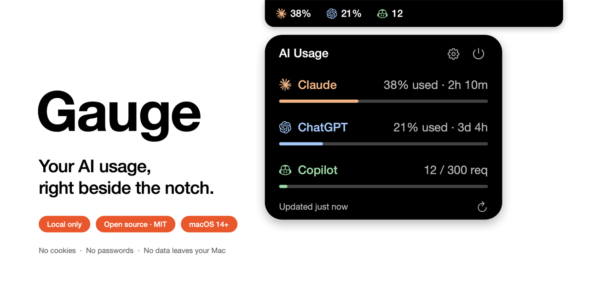
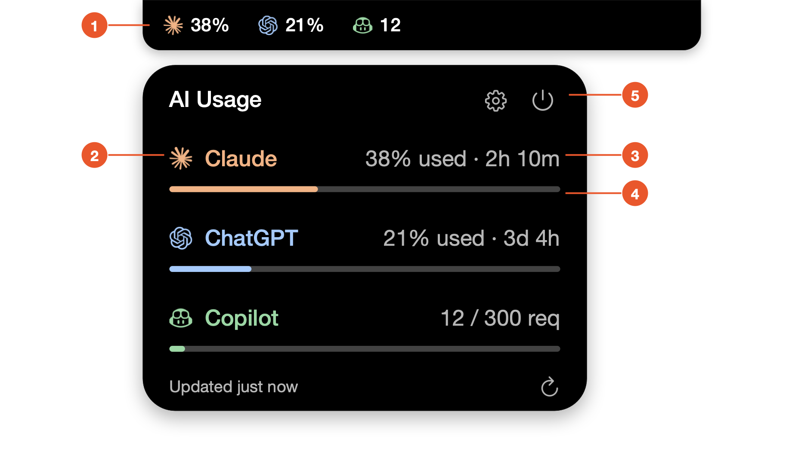
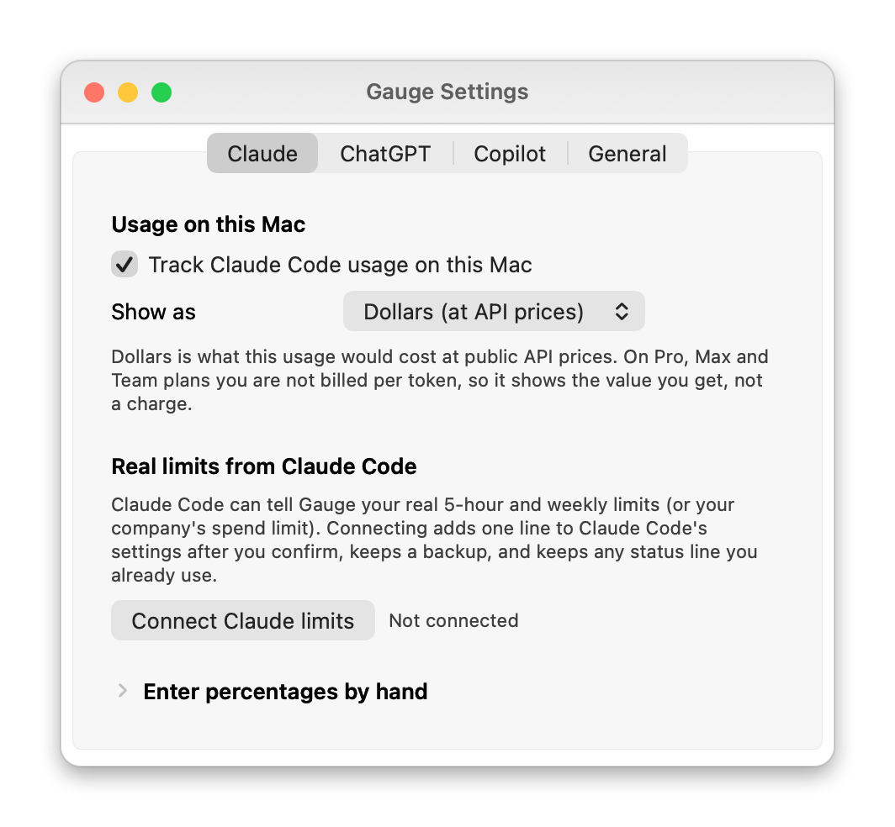
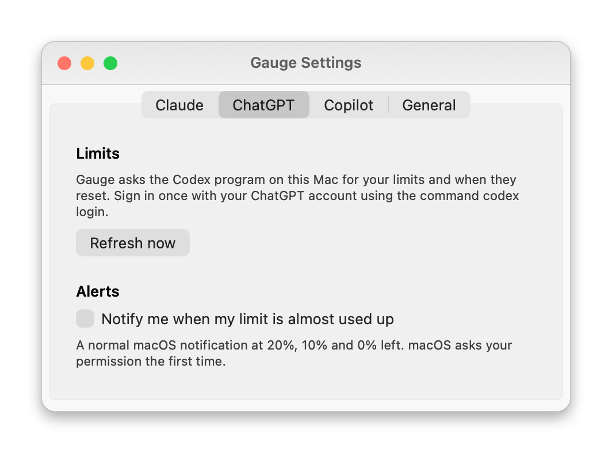
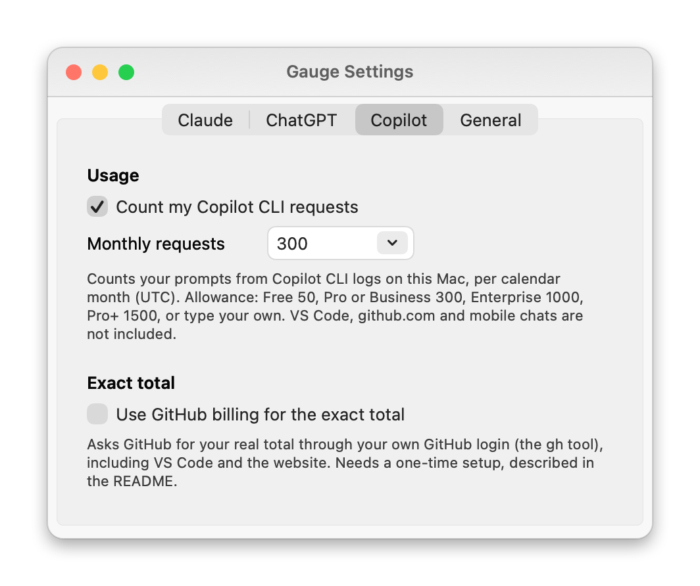
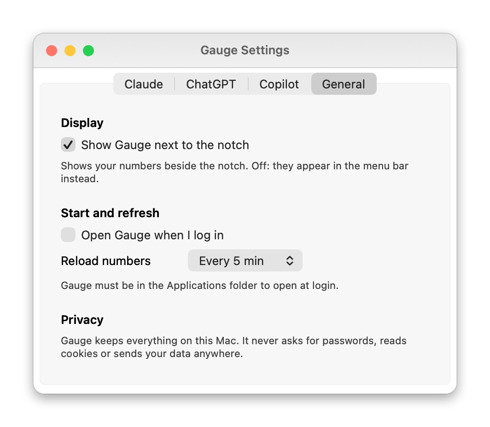

# Gauge

<p align="center">
  
</p>

<p align="center">
  <a href="../../releases/latest"></a>
  <a href="LICENSE"></a>
  
  
</p>

**Gauge shows how much of your AI tools you have used, right at the top of your Mac screen.**

It works with **Claude Code**, **ChatGPT (Codex)** and **GitHub Copilot**. You glance at the top of the screen, you see the numbers, you move on. No windows to open, no websites to visit.

On a MacBook with a notch, the numbers sit next to the notch. Move the mouse onto them and a small card opens with more detail.

### What you get

- **A glance at the top of the screen:** a logo and a short value per tool beside the notch (or in the menu bar on Macs without one).
- **A card on hover** with a progress bar per tool and a breakdown by project. Everything is shown as **what you have used**, so a bigger number or a fuller bar always means more spent.
- **Claude Code:** what the current 5-hour session cost, in dollars at API prices or in tokens, plus your **real limit and reset time** (or your company's spend and budget) once you connect it with one click.
- **ChatGPT (Codex):** your real 5-hour and weekly limits with reset countdowns, and optional alerts.
- **GitHub Copilot:** premium requests this month against your plan's allowance, with an optional exact total from GitHub.
- **Private by design:** open source (MIT), no cookies, no passwords, no data collected, nothing leaves your Mac.

> You do not need to be technical to use Gauge. This guide explains every step in plain words.

---

## Contents

1. [Is it safe? Your privacy](#1-is-it-safe-your-privacy)
2. [What you need](#2-what-you-need)
3. [Install Gauge](#3-install-gauge)
4. [Open Gauge and find it on screen](#4-open-gauge-and-find-it-on-screen)
5. [Start Gauge automatically when you turn on your Mac](#5-start-gauge-automatically-when-you-turn-on-your-mac)
6. [Connect your AI tools](#6-connect-your-ai-tools)
7. [How to read the card](#7-how-to-read-the-card)
8. [Settings, one by one](#8-settings-one-by-one)
9. [Understanding the numbers](#9-understanding-the-numbers)
10. [Something is not working](#10-something-is-not-working)
11. [Quit and uninstall](#11-quit-and-uninstall)
12. [For developers](#12-for-developers)

---

## 1. Is it safe? Your privacy

Short answer: **yes. Gauge keeps everything on your Mac.**

- **No cookies.** Gauge never looks at your web browser, your logins or your cookies.
- **No passwords.** It never asks for a password, a key or a token, and it never stores one.
- **No data collected.** There is no tracking, no analytics and no account. Nothing about you or your usage is sent to the author or to anyone else.
- **No internet connection of its own.** Gauge does not talk to any server. The only time it touches the web is when *you* press the button **Open Claude usage page**, which simply opens a web page in your browser.
- **Open source.** Every line of the program is public on GitHub, under the free [MIT license](LICENSE). Anyone can read it, check it, and build the app themselves. You do not have to take our word for it.

**What Gauge actually does:** it reads small "history" files that your AI tools already save on your own Mac (for example, a note each time Claude Code answers you), and adds them up. It only *reads* them. It never changes or deletes them.

Three optional features use programs you already have:

- **ChatGPT limits** come from the Codex program on your Mac. That program talks to OpenAI the way it always does. Gauge only asks it for the result.
- **Real Claude limits** (switched off until you press **Connect**) come from Claude Code itself. Claude Code can run a small command every time it updates its status bar and hand it your limits; Gauge is that command, and it saves the numbers in one small file on your Mac. Connecting adds one line to Claude Code's settings file; you can undo it with one click. See [section 6](#optional-real-claude-limits-from-claude-code).
- **Exact GitHub Copilot totals** (switched off by default) come from GitHub's own `gh` program, using the login you already have. Gauge never sees your password or token.

The names of your project folders may appear on the card. They come from those history files and stay on your Mac.

---

## 2. What you need

- A **Mac** with **macOS 14 (Sonoma) or newer**. To check: click the Apple logo in the top-left corner → **About This Mac**. Both Apple Silicon (M1, M2, M3, M4...) and older Intel Macs work.
- At least **one** of these AI tools, already installed and used on this Mac. You do not need all three:
  - **Claude Code**
  - **ChatGPT through the Codex program**
  - **GitHub Copilot through the Copilot command-line tool**

If a tool is not on your Mac, Gauge simply does not show it. Each tool appears on the card, next to the notch and in the menu bar only after Gauge has found it. If it finds none, the card says "No AI tools found yet" and tells you what to do.

> **Good to know:** Gauge sees what happens *on this Mac*. Chatting on a website (like claude.ai or chatgpt.com), in your phone app, or on another computer is not counted.

---

## 3. Install Gauge

1. Open the [Releases page](../../releases) and download **Gauge.zip** from the newest release (under **Assets**).
2. Open your **Downloads** folder and **double-click Gauge.zip**. A file called **Gauge** (with a gauge icon) appears next to it.
3. **Drag Gauge into your Applications folder.** (Open Finder, click **Applications** in the left column, and drop Gauge there.) This step matters: automatic start and notifications only work from the Applications folder.

### The first time you open it: macOS will show a warning

Gauge is a free app that Apple has not reviewed ("notarized"), so macOS asks you to confirm it. This is normal and happens once.

**On macOS 15 (Sequoia) or newer:**

1. Open **Applications** and double-click **Gauge**.
2. A message says the app cannot be verified. Click **Done** (do not click "Move to Trash").
3. Click the Apple logo → **System Settings** → **Privacy & Security**.
4. Scroll down to the **Security** section. You will see "Gauge was blocked". Click **Open Anyway**.
5. Type your Mac password (or use Touch ID) and click **Open Anyway** once more.

**On macOS 14:**

1. Open **Applications**, **hold the Control key and click Gauge** (or right-click it), then choose **Open**.
2. Click **Open** in the message.

After that, Gauge opens normally every time.

---

## 4. Open Gauge and find it on screen

Gauge does not open a big window and does not appear in the Dock at the bottom. It lives at the very top of the screen. Right after you open it, look there.

**On a MacBook with a notch:** look at the notch. To its left you will see a small black area with a logo and a number for each tool you use. In the menu bar (the strip at the very top) you will also see a small **gauge icon**.

**On a Mac without a notch:** the numbers appear in the menu bar at the top, each with its tool's logo. A small black pill with the same numbers also sits at the top centre of the screen (you can turn it off in Settings).

### Open the card

- **Move the mouse onto the numbers** next to the notch. A card unfolds just below. Move the mouse away and it folds back.
- Or **click the gauge icon / numbers in the menu bar**. The same card opens. Click anywhere else to close it.

### The buttons on the card

| Button | What it does |
|--------|--------------|
| ⟳ (bottom right) | Reload the numbers right now |
| ⚙ (top right, gear) | Open Settings |
| ⏻ (top right, power) | Quit Gauge |

### The menu-bar menu

**Right-click** the gauge icon (or **Control-click**) to get a small menu: **Refresh**, **Settings…** and **Quit Gauge**.

### Open it again later

If you quit Gauge, open it again from **Applications**, from **Launchpad**, or press **⌘ Space** (Command + Spacebar), type **Gauge**, and press **Return**.

> **Cannot see the icon?** When the menu bar is crowded, macOS hides some icons behind the notch. Hold the **⌘ Command** key and drag a few icons you do not need out of the menu bar, or quit an app that has many icons.

---

## 5. Start Gauge automatically when you turn on your Mac

You can have Gauge open by itself every time you log in, so it is always there.

1. Make sure Gauge is in your **Applications** folder (see step 3).
2. Open Gauge's **Settings** (click the gear on the card, or right-click the menu-bar icon → **Settings…**).
3. Open the **General** tab and tick **Open Gauge when I log in**.

To turn it off, untick the same box.

If the tick does not stay on, add it yourself in macOS: Apple logo → **System Settings** → **General** → **Login Items** → click **+** under "Open at Login" → choose **Gauge** from Applications.

---

## 6. Connect your AI tools

"Connecting" here just means: the tool is installed on your Mac and you have signed in to it. **Gauge has no login screen of its own.** It simply finds what the tool already left on your Mac.

### Claude Code: nothing to do

If you use Claude Code, Gauge shows it automatically. It adds up what you used in the current 5-hour session and in the last 7 days.

This gives you an estimate of what you spent (in dollars or tokens). To see your **real limit** as a percentage, connect Claude Code's limits (next part). You can also type in the percentages from the Claude website; see [Settings](#claude-manual-numbers).

#### Optional: real Claude limits from Claude Code

Claude does not let other programs read your limit directly, but Claude Code itself knows it and can pass it on. This works if you have a **Claude Pro, Max or Ultra** subscription, or if your company runs Claude Code behind a gateway with a **spend limit** (then you also see your spend and budget in dollars).

1. Open Gauge's **Settings** (gear on the card) and go to the **Claude** tab.
2. Under **Real limits from Claude Code**, click **Connect Claude limits**.
3. Gauge explains what it will change. Click **Connect**.
4. Use Claude Code as usual. After its next reply, the Claude row shows how much of your real limit you have used and when it resets. Claude Code sessions that were already open may need a restart.

What this does: it adds one entry called `statusLine` to Claude Code's settings file (`~/.claude/settings.json`). Gauge saves a backup copy next to it first (`settings.json.gauge-backup`). If you already have your own status line, it keeps working: Gauge passes the information on to it. Click **Disconnect** in the same place to put everything back exactly as it was.

**Work computers:** some companies tell Claude Code to ignore status lines and hooks that the company did not set up itself. If yours does, Claude Code silently skips Gauge's, so no limits can arrive. Gauge detects this and says "Blocked by your organization's Claude Code policy" in Settings instead of failing quietly. It does not try to get around the policy: ask your IT or Claude administrator to allow it. Gauge keeps working with its estimate from Claude Code's logs, and you can type your percentages by hand.

If you move Gauge out of the Applications folder, click Disconnect and then Connect again. Plans that do not report limits (for example pay-per-use API keys) show nothing extra here, and Settings tells you so.

### ChatGPT (Codex): one-time setup

For ChatGPT, Gauge needs the **Codex** program, signed in with your **ChatGPT account** (not an API key).

You only do this once. It uses an app called **Terminal**, which is already on your Mac. Terminal is a window where you type short instructions. You will only copy, paste and press Return.

1. **Install Codex.** Follow the *Installation* section at [github.com/openai/codex](https://github.com/openai/codex). It tells you the exact line to paste.
2. **Open Terminal:** press **⌘ Space**, type **Terminal**, press **Return**.
3. **Sign in:** copy this line, click in the Terminal window, paste with **⌘ V**, and press **Return**:

   ```
   codex login
   ```

4. Your web browser opens. Sign in with your ChatGPT account and approve.
5. Back in Gauge, click ⟳. The ChatGPT row now shows how much of your limit you have used, and when it resets.

If you do not use Codex, simply skip this. The ChatGPT row only appears once Gauge finds Codex on your Mac.

### GitHub Copilot: nothing to do (if you use its command-line tool)

If you use the **GitHub Copilot command-line tool** (see [GitHub's Copilot docs](https://docs.github.com/copilot)), Gauge counts your requests automatically, month by month. A "Copilot" row appears once the tool has been used on this Mac.

Copilot in **VS Code**, on **github.com** or on your **phone** is not visible to Gauge. If you use those too, the number will be lower than the real one. For the real total, see the next part.

#### Optional: exact Copilot total from GitHub

This is switched off by default. It asks GitHub for your real number, including VS Code and the website.

1. Install GitHub's `gh` tool from [cli.github.com](https://cli.github.com) and sign in. In Terminal (see above), run: `gh auth login`.
2. In Terminal, run:

   ```
   gh auth refresh -h github.com -s user
   ```

   GitHub asks for a permission called "user". GitHub requires it for billing numbers. If you are not comfortable with it, simply skip this step: Gauge works fine without it.
3. In Gauge's Settings, open the **Copilot** tab and tick **Use GitHub billing for the exact total**.

If it does not work (for example because your company manages your GitHub account), Gauge tells you why in Settings and keeps using the numbers from your Mac.

---

## 7. How to read the card

<p align="center">
  
</p>

1. **The island** next to the notch: a logo and a short value for each tool. This is what you see all the time.
2. **The tool's logo and name.** Move the mouse onto a row to see a breakdown.
3. **The main figure** on the right: how much you have used, and when it resets.
4. **The bar**: how much of the limit is used. It fills as you spend and turns red when it is nearly used up.
5. **Buttons**: the gear opens Settings, the power button quits Gauge. The arrow at the bottom right reloads the numbers.

The card has one row per tool. Each row has:

- **The tool's logo and name** (Claude, ChatGPT, Copilot).
- **A number on the right**, for example `$10.8` or `21% used`.
- **A coloured bar** underneath that fills as you use more. It turns **red** when you are close to the limit.
- For Claude, if you have neither connected the limits nor typed in percentages, a **short note** instead of a bar, saying what the number is (see below). Without your real limit there is nothing true to draw as a bar.

What the text means for each tool:

| Tool | Text | Meaning |
|------|------|---------|
| **Claude** | `$10.8` and the note *This 5-hour session · 1h 18m left* | What this 5-hour session cost at normal public prices, and how long until the session ends. In tokens mode, it shows a token count instead of dollars. |
| **Claude** (idle) | `$270` and the note *No active session · last 7 days* | No session is running. This is the total for the last 7 days. |
| **Claude** (limits connected) | `38% used · 2h 10m` and a bar | Your real limit: how much of the fullest window (5-hour or weekly) is used and when it resets. With a company spend limit it reads like `$314 / $500 · 12d 3h`. If Claude Code has not reported for a while it says *Stale*. |
| **Claude** (with percentages typed in) | `38% used` and a bar | The percentage you copied from the Claude website. |
| **ChatGPT** | `21% used · 3d 4h` | How much of your limit is used, and when it resets. |
| **Copilot** | `12 / 300 req` | Requests used this month out of your monthly allowance. |

**Move the mouse onto a row** to see a breakdown: which projects used how much. For ChatGPT it also shows both limits (the 5-hour one and the weekly one) with their reset times.

The numbers next to the notch are the same values in short form.

---

## 8. Settings, one by one

Open Settings with the **gear** on the card, or right-click the menu-bar icon → **Settings…**. The window has four tabs, one per tool, plus **General**. Each setting lives only in its own tab.

### Claude tab

<p align="center">
  
</p>

**Usage on this Mac**

| Setting | What it does |
|---------|--------------|
| **Track Claude Code usage on this Mac** | On: Gauge reads Claude Code's history on your Mac and shows your usage. Off: Gauge stops reading it. |
| **Show as** | **Dollars (at API prices)** shows what your usage would cost at Anthropic's public prices. **Tokens** shows the raw amount of text processed. On Pro, Max and Team plans you are not billed per token, so dollars shows the value you get, not a charge. |

**Real limits from Claude Code**

| Setting | What it does |
|---------|--------------|
| **Connect Claude limits / Disconnect** | Connect: lets Claude Code pass Gauge your real limits (see [section 6](#optional-real-claude-limits-from-claude-code)). Disconnect: removes the entry and restores your previous settings. The text next to the button says whether it is connected, when numbers last arrived, or if your organization blocks it. |

**Enter percentages by hand** (click the arrow to open it)

<a id="claude-manual-numbers"></a>

Only needed if you do not connect real limits. Copy the percentages from claude.ai → Settings → Usage. A value saved less than an hour ago is shown instead of dollars or tokens.

| Setting | What it does |
|---------|--------------|
| **5-hour window used** | The percentage used in your 5-hour window, as claude.ai shows it. |
| **Weekly limit used** | The percentage used for the week. |
| **Window resets at** | When your 5-hour window resets. |
| **Save** | Saves the three values above. |
| **Clear** | Deletes the saved values. |
| **Open Claude usage page** | Opens Claude's usage page in your browser so you can copy the numbers. |

### ChatGPT tab

<p align="center">
  
</p>

| Setting | What it does |
|---------|--------------|
| **Refresh now** | Asks Codex for fresh numbers right away. |
| **Notify me when my limit is almost used up** | Sends a normal macOS notification when your ChatGPT (Codex) limit is 80%, 90% and 100% used. macOS asks your permission the first time. |

### Copilot tab

<p align="center">
  
</p>

| Setting | What it does |
|---------|--------------|
| **Count my Copilot CLI requests** | On: counts your requests from the Copilot command-line tool, month by month. Off: hides the Copilot row. |
| **Monthly requests** | Your plan's monthly allowance. Pick one (Free 50, Pro or Business 300, Enterprise 1000, Pro+ 1500) or type your own number. The bar is drawn against this number. |
| **Use GitHub billing for the exact total** | Off by default. On: asks GitHub for your real total, including VS Code and the website. Needs the one-time setup in [section 6](#optional-exact-copilot-total-from-github). |

### General tab

<p align="center">
  
</p>

| Setting | What it does |
|---------|--------------|
| **Show Gauge next to the notch** | On: the black area next to the notch (or at the top of the screen) with your numbers. Off: it disappears and the numbers move to the menu bar. |
| **Open Gauge when I log in** | Opens Gauge automatically when you log in to your Mac. |
| **Reload numbers** | How often Gauge reloads the numbers: every 1, 5, 10 or 15 minutes. 5 is a good choice. |

---

## 9. Understanding the numbers

- **Everything is "used".** Dollars, percentages and requests all show how much you have spent, never how much is left. Bigger means more used.
- **Dollars are not a bill.** They are an estimate of what the same usage would cost at the normal public prices of Anthropic's service. If you use a subscription (Pro, Max, Team), you do not pay per token, so the dollar figure is just a way to compare days and projects. If your company pays by usage, it is a good guide, but your real invoice may be a little different because of discounts and extras.
- **Only this Mac is counted.** Using a website, a phone app or another computer does not appear in Gauge.
- **Claude's real limit needs one click.** Claude Code knows your limit but only hands it over once you **Connect** it in Settings (see [section 6](#optional-real-claude-limits-from-claude-code)). Until then Claude shows a note about your session instead of a bar. ChatGPT is different: its real limit comes straight from Codex.
- **Copilot is an estimate** unless you turn on the exact total. GitHub's own billing page is always the final word.

---

## 10. Something is not working

**I opened Gauge and nothing happens.**
Gauge has no window and no Dock icon. Look at the very top of the screen (see [section 4](#4-open-gauge-and-find-it-on-screen)). If you still do not see it, quit it with the steps in section 11 and open it again.

**macOS says Gauge "cannot be opened" or "cannot be verified".**
Follow the steps under *The first time you open it* in [section 3](#3-install-gauge).

**The card does not open when I move the mouse near the notch.**
Click the gauge icon in the menu bar instead; it always works. Some work-managed Macs restrict mouse tracking, and then only the icon works.

**There is no ChatGPT row, or it says "Unavailable".**
Codex is probably not installed or not signed in. Follow [the ChatGPT steps](#chatgpt-codex-one-time-setup). Make sure you signed in with your ChatGPT account, not an API key.

**The card says "No AI tools found yet".**
Gauge did not find Claude Code, Codex or the Copilot command-line tool on this Mac. Install and sign in to at least one, use it once, then click ⟳ on the card.

**There is no Copilot row.**
It appears only after the Copilot command-line tool has been used on this Mac. If you only use Copilot in VS Code, turn on the exact total (see [section 6](#optional-exact-copilot-total-from-github)).

**The numbers are different from the website.**
Gauge counts only this Mac, and Claude and Copilot numbers are estimates (see [section 9](#9-understanding-the-numbers)).

**Settings says "Blocked by your organization's Claude Code policy".**
Your company's Claude Code settings only allow status lines that the company manages, so Claude Code ignores Gauge's. Ask your administrator to allow it. Until then, use the estimate or type your percentages by hand.

**Claude shows a note instead of a bar, or says `Stale`.**
The real limit appears after you click **Connect Claude limits** and Claude Code replies once. It says *Stale* when Claude Code has not reported for a while (for example if you only use Claude on the website). Numbers refresh every few minutes; click ⟳ to refresh now.

**Claude says "No active session" or shows an old number.**
"No active session" is normal when you have not used Claude Code for five hours: the session starts again with your next message. Numbers refresh every few minutes; click ⟳ on the card to refresh now.

**I turned on "Open Gauge when I log in", but it does not start.**
Make sure Gauge is in the **Applications** folder, then switch the setting off and on again, or add it in **System Settings → General → Login Items** (see [section 5](#5-start-gauge-automatically-when-you-turn-on-your-mac)).

---

## 11. Quit and uninstall

**Quit Gauge:** click the ⏻ button on the card, or right-click the menu-bar icon → **Quit Gauge**, or press **⌘ Q** in that menu.

**Uninstall:**

1. If you connected Claude limits, open Settings and click **Disconnect** first.
2. Quit Gauge (above).
3. Open **Applications** and drag **Gauge** to the **Trash**.
4. If you switched on "Open Gauge when I log in", also remove Gauge from **System Settings → General → Login Items**.

Gauge saves only your settings, plus the latest Claude limits if you connected them, in small files on your Mac (`~/Library/Preferences` and `~/Library/Application Support/Gauge`). Nothing else is left behind, and Gauge never changed your AI tools' files.

---

## 12. For developers

Gauge is native macOS (AppKit) with no third-party dependencies. It requires macOS 14+ and the Xcode Command Line Tools (`xcode-select --install`).

```bash
swift run Gauge        # run directly
./build-app.sh         # builds dist/Gauge.app (universal) and dist/Gauge.zip
```

`build-app.sh` produces an ad-hoc-signed bundle. For Launch at Login and notifications, run the `.app` rather than `swift run`.

### Where the numbers come from

| Service | Source |
|---------|--------|
| Claude Code | local logs in `~/.claude/projects`, priced with Anthropic's public list prices; real limits through Claude Code's status line (`Gauge --statusline` reads `rate_limits` from stdin and saves it) |
| ChatGPT / Codex | `codex app-server` over local stdio for limits; `~/.codex/sessions` for per-project tokens |
| GitHub Copilot | `~/.copilot/session-state`; optionally `gh api` for billing |

Log readers are incremental: the first scan takes a few seconds, later refreshes take milliseconds. Adding a service means producing one `ProviderCard` in `AppModel.cards`; the card, the island and the menu bar pick it up.

### License and notices

- Released under the [MIT License](LICENSE). Contributions are welcome through issues and pull requests.
- Gauge is **not** an official Anthropic, OpenAI or GitHub product.
- The service logos come from [simple-icons](https://github.com/simple-icons/simple-icons) (CC0). They remain trademarks of their owners and are used only to tell the services apart.
